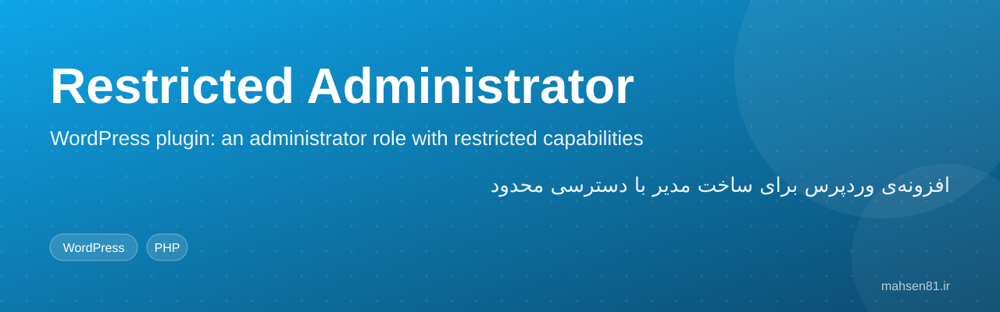

<!-- gen:header -->
<p align="center"></p>

<h1 align="center">Restricted Administrator</h1>
<p align="center"><b>افزونه‌ی وردپرس برای ساخت مدیر با دسترسی محدود</b><br><i>WordPress plugin: an administrator role with restricted capabilities</i></p>
<p align="center"> </p>

<div dir="rtl">

## ✨ امکانات

- نقش مدیر با دسترسی‌های قابل کنترل
- حذف تمیز با uninstall.php
- سبک و بدون وابستگی

</div>

## 🚀 Quick start

```bash
Copy restricted-administrator/ to wp-content/plugins/ and activate.
```

---

<p align="center">ساخته‌شده توسط <a href="https://mahsen81.ir"><b>محسن جباره‌اصل</b></a> — برنامه‌نویسی، طراحی سایت، ربات و هوش مصنوعی<br>
Built by <a href="https://mahsen81.ir">Mohsen Jabbareh-Asl</a> · ⭐ اگر مفید بود، ستاره بدهید · Need a custom version? <a href="https://mahsen81.ir">Get in touch</a></p>
